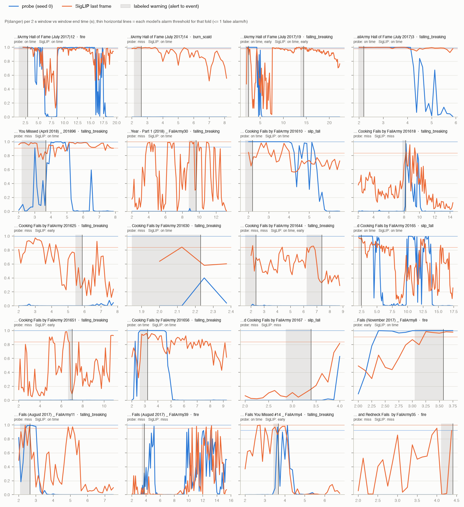

## Shortcut audit

pre-alert AUC: pre-alert windows of fail clips vs normal-cooking windows (0.5 = can't tell them apart before danger is visible). Fires: share of windows at or above the fold's alarm threshold.

| method | pre-alert AUC | pre-alert | gap | warning | after | youtube | charades | epic |
|---|---|---|---|---|---|---|---|---|
| badas | 0.682 | 0.000 | 0.000 | 0.000 | 0.000 | 0.006 | 0.000 | 0.000 |
| prior | 0.500 | 0.000 | 0.000 | 0.000 | 0.000 | 0.000 | 0.000 | 0.000 |
| probe | 0.714 | 0.018 | 0.069 | 0.268 | 0.116 | 0.020 | 0.000 | 0.000 |
| siglip_lr | 0.928 | 0.071 | 0.099 | 0.336 | 0.276 | 0.058 | 0.000 | 0.000 |
| vjepa_lr | 0.746 | 0.009 | 0.000 | 0.027 | 0.033 | 0.009 | 0.000 | 0.000 |

## Outcome by hazard (share of accidents; probe averaged over seeds)

| method | hazard | n | on time | early | miss |
|---|---|---|---|---|---|
| probe | appliance | 1 | 0.00 | 0.00 | 1.00 |
| probe | burn_scald | 7 | 0.43 | 0.10 | 0.48 |
| probe | falling_breaking | 42 | 0.33 | 0.06 | 0.61 |
| probe | fire | 7 | 0.33 | 0.29 | 0.38 |
| probe | impact | 3 | 0.11 | 0.00 | 0.89 |
| probe | other | 3 | 0.22 | 0.00 | 0.78 |
| probe | slip_fall | 18 | 0.11 | 0.02 | 0.87 |
| siglip_lr | appliance | 1 | 0.00 | 0.00 | 1.00 |
| siglip_lr | burn_scald | 7 | 0.57 | 0.29 | 0.14 |
| siglip_lr | falling_breaking | 42 | 0.40 | 0.17 | 0.43 |
| siglip_lr | fire | 7 | 0.57 | 0.14 | 0.29 |
| siglip_lr | impact | 3 | 0.33 | 0.00 | 0.67 |
| siglip_lr | other | 3 | 0.33 | 0.33 | 0.33 |
| siglip_lr | slip_fall | 18 | 0.33 | 0.22 | 0.44 |

