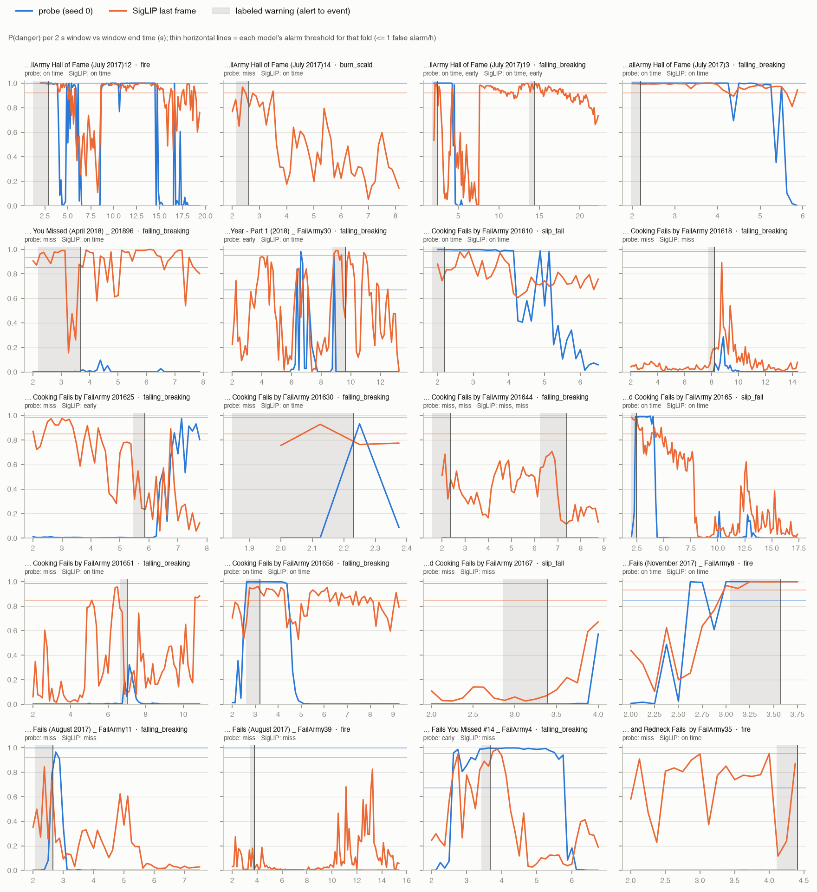

## Shortcut audit

pre-alert AUC: pre-alert windows of fail clips vs normal-cooking windows (0.5 = can't tell them apart before danger is visible). Fires: share of windows at or above the fold's alarm threshold.

| method | pre-alert AUC | pre-alert | gap | warning | after | youtube | charades | epic |
|---|---|---|---|---|---|---|---|---|
| badas | 0.682 | 0.000 | 0.000 | 0.000 | 0.000 | 0.004 | 0.000 | 0.000 |
| cosmos | 0.782 | 0.011 | 0.008 | 0.110 | 0.153 | 0.020 | 0.000 | 0.000 |
| prior | 0.500 | 0.000 | 0.000 | 0.000 | 0.000 | 0.000 | 0.000 | 0.000 |
| probe | 0.659 | 0.020 | 0.082 | 0.228 | 0.094 | 0.001 | 0.000 | 0.000 |
| siglip_lr | 0.910 | 0.075 | 0.107 | 0.301 | 0.212 | 0.004 | 0.000 | 0.000 |
| vjepa_lr | 0.680 | 0.009 | 0.004 | 0.017 | 0.034 | 0.001 | 0.000 | 0.000 |

## Outcome by hazard (share of accidents; probe averaged over seeds)

| method | hazard | n | on time | early | miss |
|---|---|---|---|---|---|
| probe | appliance | 1 | 0.00 | 0.00 | 1.00 |
| probe | burn_scald | 7 | 0.43 | 0.00 | 0.57 |
| probe | falling_breaking | 42 | 0.31 | 0.06 | 0.63 |
| probe | fire | 7 | 0.33 | 0.29 | 0.38 |
| probe | impact | 3 | 0.00 | 0.00 | 1.00 |
| probe | other | 3 | 0.11 | 0.00 | 0.89 |
| probe | slip_fall | 18 | 0.11 | 0.07 | 0.81 |
| siglip_lr | appliance | 1 | 0.00 | 0.00 | 1.00 |
| siglip_lr | burn_scald | 7 | 0.71 | 0.14 | 0.14 |
| siglip_lr | falling_breaking | 42 | 0.40 | 0.14 | 0.45 |
| siglip_lr | fire | 7 | 0.57 | 0.14 | 0.29 |
| siglip_lr | impact | 3 | 0.33 | 0.00 | 0.67 |
| siglip_lr | other | 3 | 0.00 | 0.33 | 0.67 |
| siglip_lr | slip_fall | 18 | 0.33 | 0.33 | 0.33 |

